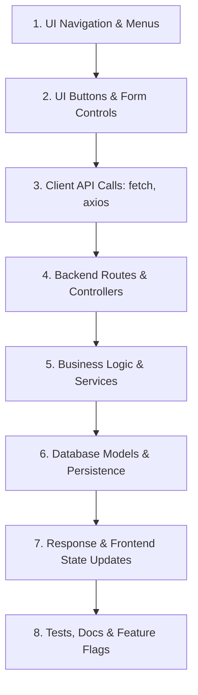

# Ghost Feature Detection Playbook

> **What is a Ghost Feature?**  
> A ghost feature is a software feature that appears to exist in some layer of an application (UI navigation, buttons, documentation, client requests, or route declarations) but has a **missing, incomplete, or disconnected implementation path**.

Ghost features erode user trust and confuse developers. They give the impression of functionality while failing silently or producing unexpected errors at runtime.

---

## 1. The 8-Layer Feature Connection Chain

Ghost Hunt evaluates feature integrity across eight distinct architectural layers:



A healthy feature forms an unbroken chain from Layer 1 through Layer 8. A broken or missing link anywhere in this chain produces a **`ghost_feature_candidate`**.

---

## 2. Common Ghost Feature Archetypes

### Archetype A: UI Navigation to Missing Destination
- **Symptom:** Navigation menu or footer includes a link (`<Link href="/analytics">` or `<a href="/billing">`), but no route handler, page component, or template exists for `/analytics`.
- **Finding Category:** `ghost_feature_candidate`
- **Chain Stage:** `UI Navigation -> Destination Page`
- **Impact:** User encounters an HTTP 404 or white screen.

### Archetype B: Action Button with Empty Handler
- **Symptom:** A prominent button ("Export CSV", "Delete Account", "Sync Data") is displayed, but its event handler is a no-op (`onClick={() => {}}` or missing `onClick`).
- **Finding Category:** `ghost_feature_candidate`
- **Chain Stage:** `UI Action -> Event Handler`
- **Impact:** Clicking the button does nothing; users assume the software is frozen or broken.

### Archetype C: Form Without Submission Pipeline
- **Symptom:** A form renders inputs (`<input>`, `<textarea>`, `<select>`) but lacks both an `action` attribute and an `onSubmit` handler.
- **Finding Category:** `ghost_feature_candidate`
- **Chain Stage:** `UI Form -> Submission Pipeline`
- **Impact:** User fills out form data, but clicking Submit triggers a page refresh without persisting or processing data.

### Archetype D: Client Call to Nonexistent Endpoint
- **Symptom:** Client code sends an HTTP request (`fetch('/api/v1/refunds', { method: 'POST' })`), but no backend route handler exists for `/api/v1/refunds`.
- **Finding Category:** `ghost_feature_candidate` / `missing_route`
- **Chain Stage:** `Client API Request -> Backend Route`
- **Impact:** Request fails with HTTP 404 at runtime.

### Archetype E: HTTP Method Mismatch
- **Symptom:** Client sends `POST /api/orders`, but the matching backend route only permits `['GET']`.
- **Finding Category:** `ghost_feature_candidate` / `method_path_mismatch`
- **Chain Stage:** `Client Request -> Route Method Compatibility`
- **Impact:** Request fails with HTTP 405 Method Not Allowed.

### Archetype F: Route with Empty or Unfinished Handler
- **Symptom:** Route is declared (`@app.get('/api/reports')`), but its handler function body contains only `pass`, `...`, `raise NotImplementedError`, or a placeholder return.
- **Finding Category:** `ghost_feature_candidate` / `empty_or_unfinished_implementation`
- **Chain Stage:** `Backend Route -> Service Logic`
- **Impact:** Calling the endpoint raises an unhandled 500 error or returns empty dummy data.

### Archetype G: Orphaned Business Service
- **Symptom:** A service function (`process_manual_reversal()`) exists with business logic, but no route, CLI command, or background job ever invokes it.
- **Finding Category:** `ghost_feature_candidate`
- **Chain Stage:** `Business Logic -> Application Entry Point`
- **Impact:** Dead code or abandoned feature implementation taking up maintenance overhead.

### Archetype H: Unreachable UI Page
- **Symptom:** A page component exists (`pages/legacy-analytics.tsx`), but no navigation links, redirects, or router paths reference it.
- **Finding Category:** `ghost_feature_candidate`
- **Chain Stage:** `Navigation -> UI Page`
- **Impact:** Dead page consuming bundle size without being accessible to users.

---

## 3. Ghost Feature Finding Schema

Every ghost feature candidate must be reported using this structured schema:

```markdown
### [GHOST FEATURE] UI Action -> Event Handler
- **ID:** `ghost-btn-1`
- **Severity:** Medium | **Confidence:** High
- **Chain Stage:** `UI Action -> Event Handler`
- **Source Location:** `src/components/ReportView.tsx:L45`
- **Present Links:**
  - UI action button `'Export CSV Report'` rendered at `src/components/ReportView.tsx:L45`
- **Missing Links:**
  - Event handler is empty inline no-op: `onClick={() => {}}`
- **Explanation:** Button 'Export CSV Report' is rendered in the interface but has no functional event handler.
- **Potential Impact:** Users clicking the button receive no response or feedback.
- **Why False Positive:** May be an intentional UI mockup awaiting backend service completion.
- **Recommended Action:** Wire a functional export handler or disable the button until implemented.
```

---

## 4. Distinguishing Real Defects from False Positives

Never report a ghost feature without considering dynamic and runtime architectures:

1. **Reverse Proxies & Microservices:** An endpoint called by the frontend might be handled by Nginx, Envoy, or an external API gateway rather than the local codebase.
2. **Dynamic Routing:** Next.js catch-all routes (`[...slug].tsx`) or Express regex routers can handle paths that do not have literal string matches.
3. **Public Webhooks:** Backend endpoints without frontend callers are frequently external webhooks (e.g. Stripe, GitHub, Twilio) or mobile API endpoints.
4. **Parent Event Delegation:** In frontend architectures, buttons without explicit `onClick` attributes might be handled by event delegation on parent containers.
