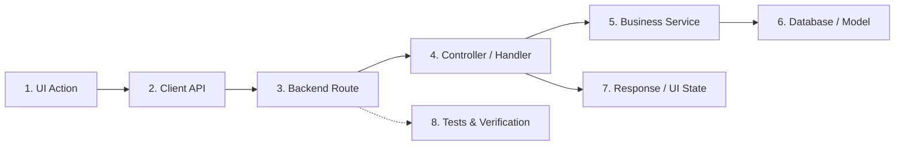

# Ghost Hunt (`ghost-hunt`)

[](https://opensource.org/licenses/Apache-2.0)
[](https://www.python.org/downloads/)
[](https://skills.sh/)
[]()

> **DON'T TRUST THE FEATURE. VERIFY IT.**

**Ghost Hunt** is an open-source, reusable codebase investigator and feature verification toolkit for AI coding agents. It helps agents and developers determine whether software features are **genuinely implemented, properly connected, functional, and verifiable** across the application's full execution path.

---

## 💡 The Problem Ghost Hunt Solves

AI coding agents are remarkably skilled at writing code that *looks* syntactically correct. However, plausible-looking code frequently breaks in production due to subtle, cross-boundary defects:

- **Disconnected Endpoints:** Frontend calls `/api/v1/orders`, but backend routes register `/api/orders`.
- **HTTP Method Mismatches:** Frontend dispatches a `POST` request to an endpoint that only accepts `GET`, triggering silent HTTP 405 errors.
- **Unfinished Stubs:** Service functions contain `pass`, `...`, or `raise NotImplementedError`.
- **Phantom Persistence:** Endpoints return HTTP 201 Created without executing a database `INSERT`.
- **Unprotected Mutations:** Controllers execute multiple database writes without an atomic transaction boundary, risking corrupted data on failure.
- **Unconsumed Responses:** Backend returns JSON payloads that the frontend client completely drops.
- **Passive Testing Gaps:** Test cases merely mention route strings without asserting response status codes or payload values.

Ghost Hunt replaces superficial code inspections with an **empirical verification discipline**.

---

## 🔗 The 8-Layer Feature Connection Engine

Ghost Hunt traces software features across all 8 architectural tiers:



1. **UI Action:** Interactive elements (`<button>`, `<a>`, `<form>`, inputs) triggering user intent.
2. **Client API:** Network dispatch (`fetch`, `axios`, `<form action>`) with HTTP verbs, URLs, and caller function tracking.
3. **Backend Route:** Web framework route declarations (`@app.route`, Express, FastAPI, Spring Boot, ASP.NET Core).
4. **Controller / Handler:** Entry handler function, authentication checks, and stub detection.
5. **Business Service:** Application service layer (`OrderService`, `PaymentProcessor`) and business logic.
6. **Database / Model:** ORM models, SQL queries, mutation counts, and atomic transaction wrappers.
7. **Response / UI State:** HTTP status codes, payload serialization, and client response consumption verification.
8. **Tests & Verification:** Verifiable test assertions (`assert res.status_code == 200`) vs passive mentions.

---

## 🤖 Supported AI Coding Agents

Ghost Hunt is built to the open [Agent Skills specification](https://skills.sh/) and works out of the box with leading AI coding agents:

| Agent | Invocation Syntax | Installation Directory |
|---|---|---|
| **Google Antigravity** | `/ghost-hunt` or `/ghost-hunt investigate <feature>` | `<project-root>/.agents/skills/ghost-hunt/` |
| **Anthropic Claude Code** | `/ghost-hunt` or `/ghost-hunt investigate <feature>` | `<project-root>/.claude/skills/ghost-hunt/` |
| **OpenAI Codex** | `$ghost-hunt` or `$ghost-hunt investigate <feature>` | `<project-root>/.agents/skills/ghost-hunt/` |

---

## ⚡ Quick Installation

### Option 1: Install the Agent Skill (Recommended)
Install the canonical skill directly into your workspace with one command using the Skills CLI (requires **Node.js 22.20.0+**):

```bash
# Interactive agent prompt:
npx skills add kalyan-dasari/ghost-feature-hunter --skill ghost-hunt

# Or install directly for your agent:
npx skills add kalyan-dasari/ghost-feature-hunter --skill ghost-hunt -y --copy --agent antigravity
npx skills add kalyan-dasari/ghost-feature-hunter --skill ghost-hunt -y --copy --agent claude-code
npx skills add kalyan-dasari/ghost-feature-hunter --skill ghost-hunt -y --copy --agent codex
```

### Option 2: Install the Optional Python CLI
For deterministic CI/CD pipelines, scripted automation, and standalone terminal audits:

```bash
pip install "ghost-feature-hunter[all]"
```

---

## 🧭 Invocations & Commands: Skill vs CLI

Ghost Hunt cleanly distinguishes between conversational **Agent Skill modes** and deterministic **Python CLI commands**:

### Conversational Agent Skill Modes (In Chat)
| Mode | Invocation | Purpose |
|---|---|---|
| **Project Discovery** | `/ghost-hunt discover` | Statically inspects the project, detects frameworks, maps route architecture, and presents available features without executing code. |
| **Feature Investigation** | `/ghost-hunt investigate <feature>` | End-to-end multi-tier investigation and safe active verification of a specific feature. |
| **Repository-Wide Audit** | `/ghost-hunt audit` | Whole-repository audit for ghost features, empty implementations, route mismatches, unused code, and duplication. |
| **Code Change Review** | `/ghost-hunt review [target]` | Reviews uncommitted, staged, or branch changes and surrounding call graph for wiring defects, security risks, and test gaps. |
| **Post-Fix Verification** | `/ghost-hunt verify <feature>` | Re-verifies approved code fixes and runs regression checks against test suites. |

### Deterministic Python CLI Commands (In Terminal)
| Command | Usage | Description |
|---|---|---|
| `ghost-hunter init` | `ghost-hunter init [-p ROOT]` | Creates conservative project configuration and a sample journey. |
| `ghost-hunter discover` | `ghost-hunter discover [-p ROOT]` | Statically catalogs routes, client calls, models, tests, and multi-language capabilities. |
| `ghost-hunter map` | `ghost-hunter map [FEATURE] [--mermaid] [--json]` | Generates the 8-layer Feature Connection Map and detects cross-layer contract issues. |
| `ghost-hunter plan` | `ghost-hunter plan <FEATURE> [-o OUTPUT]` | Plans an explicit JSON verification journey from connection map analysis. |
| `ghost-hunter audit` | `ghost-hunter audit <FEATURE> [--allow-writes]` | Executes a developer-defined JSON journey against live endpoints with evidence logging. |
| `ghost-hunter audit-routes` | `ghost-hunter audit-routes [-p ROOT]` | Statically audits route connections between backend handlers and frontend callers. |
| `ghost-hunter audit-repo` | `ghost-hunter audit-repo [-p ROOT]` | Runs comprehensive multi-language repository audit with ghost feature detection. |
| `ghost-hunter review` | `ghost-hunter review [TARGET]` | Reviews code changes and call graph for wiring defects, security risks, and test gaps. |
| `ghost-hunter report` | `ghost-hunter report <REPORT_JSON>` | Renders structured Markdown from a previously generated JSON report. |

---

## 🔍 Working Demonstration: Broken Flask Shop

Ghost Hunt includes a benchmark fixture (`examples/broken-flask-shop`) containing 15 deliberately injected defects. Here is the output of the Feature Connection Map running against the checkout feature:

```console
$ ghost-hunter map checkout -p examples/broken-flask-shop

Feature Connection Map for 'broken-flask-shop':
- Nodes: 6
- Edges: 5
- Broken Edges: 1
- Missing Edges: 1
- Orphaned Nodes: 0
- Contract Findings: 1

Feature Connection Pipeline:
UI Action ===> Client API ===> Route Handler ===> Controller ===> Service ===> Database ===> Response ===> Tests
-----------------------------------------------------------------------------------------------------------------
  [OK] POST /api/checkout --> def checkout()
  [BROKEN] GET /api/checkout -X- POST /api/checkout (HTTP Method mismatch: client calls GET, but route only accepts ['POST'])
  [OK] def checkout() --> DB Operations (0 writes, 1 reads)
  [OK] def checkout() --> Response: HTTP 201 (JSON)
  [MISSING] POST /api/checkout -X- MISSING: Test Coverage for /api/checkout (Testing gap: route lacks unit or integration test coverage)

Cross-Layer Contract Findings:
  [High] method_mismatch: HTTP method mismatch: Client sends GET, backend only supports ['POST']
    Evidence: static/shop.js:7 (GET) vs app.py:140 (['POST'])
    Fix: Add 'GET' to route handler methods or update client request.
```

Generating the visual Mermaid flowchart:

```console
$ ghost-hunter map checkout -p examples/broken-flask-shop --mermaid
```

```mermaid
graph LR
    %% Ghost Hunt 8-Layer Feature Connection Map
    subgraph CLIENT_API ["2. Client API"]
        client_call_1["GET /api/checkout"]
    end
    subgraph ROUTE ["3. Backend Route"]
        route_8["POST /api/checkout"]
    end
    subgraph CONTROLLER ["4. Controller / Handler"]
        ctrl_8_checkout["def checkout()"]
    end
    subgraph DATABASE ["6. Database / Model"]
        db_route_8["DB Operations (0 writes, 1 reads)"]
    end
    subgraph RESPONSE ["7. Response / UI State"]
        resp_route_8["Response: HTTP 201 (JSON)"]
    end
    subgraph TEST ["8. Tests & Verification"]
        test_route_8["MISSING: Test Coverage for /api/checkout"]
    end
    route_8 -->|Connected| ctrl_8_checkout
    client_call_1 -.->|BROKEN: HTTP Method mismatch: client calls GET, but route only accepts ('POST')| route_8
    ctrl_8_checkout -->|Connected| db_route_8
    ctrl_8_checkout -->|Connected| resp_route_8
    route_8 -.->|MISSING LINK| test_route_8
    style client_call_1 fill:#e8f8f5,stroke:#2ecc71,stroke-width:1px
    style route_8 fill:#e8f8f5,stroke:#2ecc71,stroke-width:1px
    style ctrl_8_checkout fill:#e8f8f5,stroke:#2ecc71,stroke-width:1px
    style db_route_8 fill:#e8f8f5,stroke:#2ecc71,stroke-width:1px
    style resp_route_8 fill:#e8f8f5,stroke:#2ecc71,stroke-width:1px
    style test_route_8 fill:#ffeaa7,stroke:#d63031,stroke-width:2px,stroke-dasharray: 5 5
```

---

## ⚖️ The Three-Status Evidence Truth Table

Ghost Hunt classifies every verification checkpoint into exactly one of three states. Never infer unasserted behavior:

| Status | Exact Definition | Permissible Interpretation |
|---|---|---|
| **`PASS`** | A check ran and its observed result affirmatively matched an authoritative requirement. | Proves **only** the executed assertion. Never infer unasserted behavior. |
| **`FAIL`** | An executed check directly contradicted an explicit expected behavior. | Proves the feature broke at this specific checkpoint. |
| **`UNKNOWN`** | Prerequisites, runtimes, clean databases, permissions, or evidence were unavailable. | **Never relabel as PASS or FAIL.** Indicates an unverified check requiring investigation. |

---

## 🛡️ Operational Safety Tiers

Ghost Hunt strictly enforces four operational safety levels:

| Tier | Category | Safety Policy | Permitted Actions |
|---|---|---|---|
| **Level 1** | **Source Inspection** | **Safe by default.** | Static file discovery, AST parsing, test reading. Never imports or executes untrusted code. |
| **Level 2** | **Runtime Read-Only** | **Safe in test environments.** | Safe HTTP probes (`GET`, `HEAD`, `OPTIONS`) and read-only database queries (`SELECT` only, capped at 1,000 rows). |
| **Level 3** | **Runtime Mutations** | **Requires user authorization.** | State-altering HTTP methods (`POST`, `PUT`, `PATCH`, `DELETE`) and browser form submissions. Must target disposable test environments. |
| **Level 4** | **Database Writes** | **Strictly isolated.** | Direct database mutations (`INSERT`, `UPDATE`, `DELETE`). Strictly prohibited against production databases. Restricted to disposable temporary databases. |

### Built-in Safeguards:
- **Production Guardrail:** All checks against production environments are blocked by default. Requires dual approval in config (`production_approved = true`) and CLI (`--approve-production`).
- **Credential Redaction:** Automatically redacts Authorization headers, passwords, secrets, API tokens, and emails from all evidence items.
- **No Unapproved Code Edits:** Always presents proposed fixes as minimal diffs for user approval before modifying code.

---

## 🌐 Language & Framework Capability Matrix

Ghost Hunt declares transparent, honest capability levels across programming language ecosystems:

| Ecosystem | Declared Level | Analysis Capabilities |
|---|---|---|
| **Python** | `deep-static` | Parser-backed AST. Route extraction (Flask, FastAPI, Django), ORM models, AST statement normalization, exception analysis, transaction boundaries. |
| **JavaScript / TypeScript** | `structural` | AST-aware lexical scanning. Route extraction (Express, Next.js), client calls (`fetch`, `axios`), UI actions (JSX/TSX button onClick callbacks), components. |
| **Go** | `structural` | Regex and structural token scanning for `net/http`, Gin, Chi, Fiber routes, struct models, and test functions. |
| **Java / Kotlin** | `structural` | Spring Boot `@GetMapping`, `@PostMapping`, controller mapping, JPA `@Entity` models, and JUnit test blocks. |
| **C# / .NET** | `structural` | ASP.NET Core controller attributes (`[HttpGet]`, `[Route]`), Minimal API calls, and Entity Framework model classes. |
| **PHP / Ruby / Rust** | `structural` | Structural route matching across Laravel, Symfony, Rails, Sinatra, Actix, and Axum. |
| **Swift / C / C++ / SQL** | `inventory-only` | File identification, line counts, and basic symbol inventory. |

---

## 📖 In-Depth Documentation

Explore detailed guides in the `docs/` directory:

- [System Architecture](docs/architecture.md) — Dual execution model, adapter architecture, and scope lock.
- [Feature Investigation Workflow](docs/feature-investigation-workflow.md) — The 11-step verification protocol.
- [Feature Connection Map](docs/connection-map.md) — 8-layer graph tracing and contract verification.
- [Verification & Evidence](docs/verification-and-evidence.md) — Truth table, PASS contract, and stateful isolation.
- [Demonstration Walkthrough](docs/demo-walkthrough.md) — Step-by-step audit of `broken-flask-shop`.
- [Benchmark Methodology](docs/benchmark-methodology.md) — Evaluation framework and scoring criteria.
- [Limitations & Boundaries](docs/limitations.md) — Transparent disclosure of static analysis limits.
- [Installation Guide](docs/installation.md) — Detailed setup for agents and CLI.
- [Safety Guide](docs/safety.md) — Security guardrails, authorization levels, and credential redaction.

---

## 🤝 Contributing

We welcome contributions from the community! Please read our [Contributing Guide](CONTRIBUTING.md) and [Code of Conduct](CODE_OF_CONDUCT.md).

To run the unit tests and benchmark suite:

```bash
# Run unit tests:
pytest tests/unit/

# Run adversarial regression suite (20 scenarios):
pytest tests/unit/test_adversarial_fixtures.py

# Run broken shop benchmark harness:
pytest tests/benchmark/test_broken_shop_benchmark.py
```

---

## 📄 License

Ghost Hunt is licensed under the [Apache License, Version 2.0](LICENSE).
