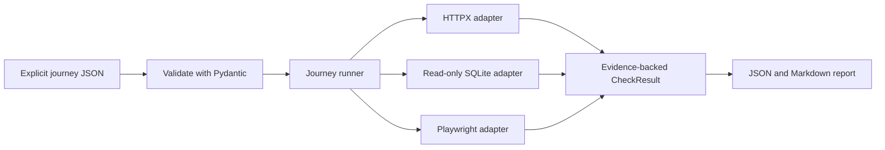

# Architecture

Ghost Feature Hunter separates expectations, observations, and interpretation:

1. A developer-authored JSON journey states what should happen at each checkpoint.
2. The runner dispatches each checkpoint to an adapter implementing the common verification interface.
3. Adapters return PASS only when configured assertions match, FAIL only when they contradict explicit expectations, and UNKNOWN when an observation is unavailable or unreliable.
4. The evidence layer sanitizes details before JSON and Markdown renderers write reports.

Project discovery is advisory. The Flask discovery module walks files and parses Python ASTs without importing or executing the application. It can identify literal Flask route decorators, common SQLAlchemy model bases, test files, frontend files, and likely service/controller files. It never converts a discovered route into an expectation.

The v0.1 core package requires Python 3.11+, Typer, Pydantic, and HTTPX. SQLite uses Python's standard library. Playwright and Flask are optional extras. Unsupported browser prerequisites produce UNKNOWN with a reason.

## Adapter contract

Each adapter accepts an `AdapterContext`, a validated `Journey`, and one `JourneyStep`, then returns a `CheckResult`. Adapters are independent and synchronous in v0.1.0. Results carry a UTC timestamp, expected and actual behavior, structured evidence references, reproducibility guidance, and confidence rationale.

## Execution flow

The v0.1 implementation does not infer requirements, correlate one adapter's mutable state to another automatically, or claim coverage beyond the journey assertions. Test-suite execution and log phrase checks are deferred. The AI agent may help write journeys and interpret evidence, but the engine, adapters, safety gates, and report totals determine status independently of the agent.
