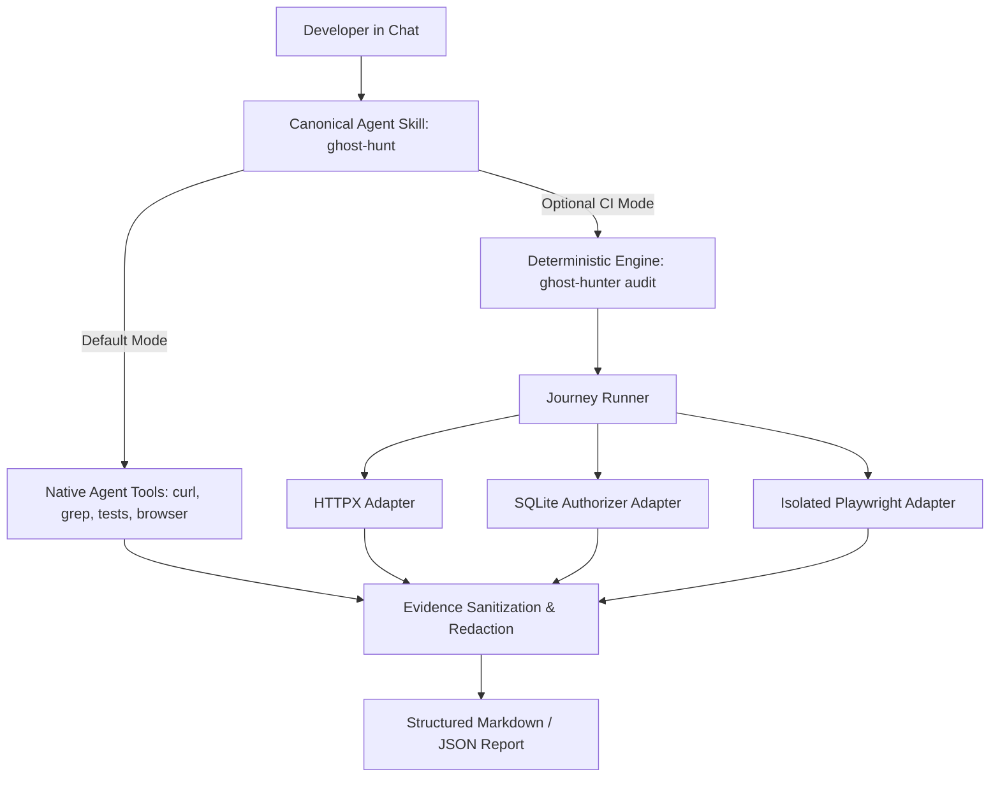
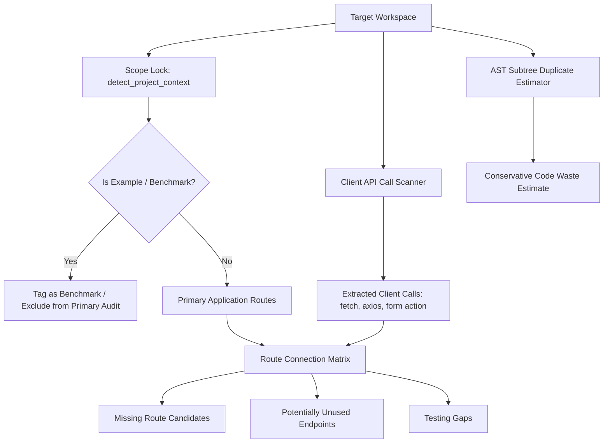
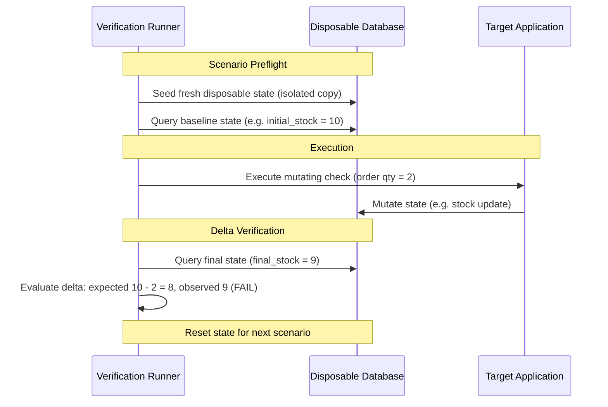

# System Architecture

Ghost Hunt is architected around the separation of **expectations**, **observations**, and **interpretation**:

1. An explicit verification specification states what should happen at each checkpoint (anchored to explicit requirement sources).
2. The verification engine or AI coding agent executes discrete checks and observes runtime behavior.
3. Observations evaluate strictly against the 3-status truth table: **`PASS`** (matches expectation), **`FAIL`** (contradicts expectation), or **`UNKNOWN`** (missing prerequisites, runtimes, or evidence).
4. Evidence is sanitized and redacted before structured Markdown or JSON reports are produced.

---

## 1. Dual Execution Architecture

Ghost Hunt provides two complementary execution pathways:

### Pathway A: Universal Agent Skill (Default)
- Installed via `npx skills add kalyan-dasari/ghost-feature-hunter --skill ghost-hunt` (conforms to the Agent Skills standard).
- AI coding agents (Google Antigravity, Anthropic Claude Code, OpenAI Codex) execute the 11-step protocol directly in chat.
- Uses native agent tools: file tools for static discovery, terminal commands (`curl`, test runners, scripts) for API and persistence checks, and agent browser tools for UI flows.
- Requires **zero external dependencies** or local Python installation.

### Pathway B: Deterministic Python Engine (Optional Companion)
- Packaged as `ghost-feature-hunter` (version 0.2.0, requires Python 3.11+).
- Executes hermetic, machine-validated JSON journeys conforming to `schemas/journey.schema.json`.
- Dispatches checkpoints to isolated adapters with strict timeout deadlines and filesystem containment.
- Generates machine-readable `ghost-report.json` and human-readable `ghost-report.md` for CI/CD test gates.

---

## 2. Adapter Architecture (Deterministic Engine)

Each adapter implements the `BaseAdapter` interface:
- Accepts an `AdapterContext`, a validated `Journey`, and one `JourneyStep`.
- Returns a validated `CheckResult` carrying a UTC timestamp, duration, expectation source, and sanitized `EvidenceItem` records.
- Enforces strict safety gates:
  - **HTTP Adapter (`ghost_hunter.adapters.http`):** Uses HTTPX. Restricts mutating methods unless write approval is configured. Caps response bodies at 2 MB. Redacts credentials.
  - **Database Adapter (`ghost_hunter.adapters.database`):** Uses Python standard library `sqlite3`. Enforces read-only SELECT queries via SQLite C-level connection authorizer callbacks (`sqlite3.Connection.set_authorizer`). Enforces 4-tier path containment.
  - **Browser Adapter (`ghost_hunter.adapters.browser`):** Uses Playwright Chromium. Runs in an isolated subprocess with OS-level process tree termination (Windows Job Objects / POSIX process groups) enforcing hard timeout deadlines.

---

---

## 4. Repository Audit Architecture & Scope Lock

Ghost Hunt includes a static audit architecture designed to analyze an entire repository without running untrusted code:

### Scope Lock & Project Detection
When analyzing repositories with nested subprojects, benchmarks, or monorepos, `detect_project_context()` establishes a verifiable scope lock:
1. **Repository vs Application Root:** Distinguishes the top-level Git repository from the application subpackage.
2. **Benchmark Isolation:** Directories named `examples/`, `fixtures/`, `benchmarks/`, or `demos/` are classified as non-primary targets. A bare `/ghost-hunt investigate` command will never default to a benchmark fixture.
3. **Explicit Override:** If the developer specifies a target path (`/ghost-hunt investigate checkout in src/backend`), the explicit path overrides directory heuristics.

### Route Connection Analysis
1. **Frontend Call Extraction:** Statically parses JavaScript, TypeScript, JSX, TSX, HTML templates, and Python views for HTTP requests (`fetch('/api/...')`, `axios.get(...)`, `<form action="...">`).
2. **Backend Route Discovery:** Parses framework decorators (`@app.route`, FastAPI routes, Express handlers) to extract route paths, HTTP methods, and parameter shapes.
3. **Cross-Boundary Matching:** Cross-references client calls against backend routes to surface:
   - **Missing Route Candidates:** Frontend calls an endpoint that has no corresponding backend route.
   - **Method Mismatches:** Frontend calls an endpoint with `POST`, but the backend only accepts `GET`.
   - **Potentially Unused Endpoints:** Backend routes with no detected caller references.
   - **Testing Gaps:** Mutation endpoints (`POST`, `PUT`, `DELETE`) with zero assertions in the existing test suite.

---

## 5. Stateful Scenario Isolation & Baseline Evidence Architecture

Stateful features (checkout, inventory, balance transfer, state machines) are susceptible to **test state contamination**, where side effects from prior checks pollute subsequent checks and create false positives.

### The PASS Evidence Contract
To award a `PASS` status to a stateful checkpoint, the runner or agent must satisfy three criteria:
1. **Pre-action Baseline:** The state prior to action must be explicitly observed and recorded.
2. **Post-action State:** The state subsequent to action must be explicitly observed.
3. **Verifiable Delta:** The delta must affirmatively match the authoritative requirement specification. Missing baseline data degrades the status to `UNKNOWN`.
