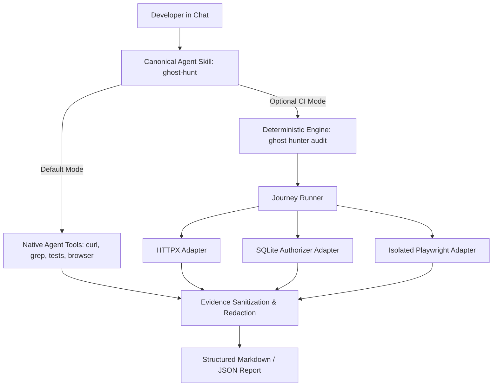

# System Architecture

Ghost Hunt is architected around the separation of **expectations**, **observations**, and **interpretation**:

1. An explicit verification specification states what should happen at each checkpoint (anchored to explicit requirement sources).
2. The verification engine or AI coding agent executes discrete checks and observes runtime behavior.
3. Observations evaluate strictly against the 3-status truth table: **`PASS`** (matches expectation), **`FAIL`** (contradicts expectation), or **`UNKNOWN`** (missing prerequisites, runtimes, or evidence).
4. Evidence is sanitized and redacted before structured Markdown or JSON reports are produced.

---

## 1. Dual Execution Architecture

Ghost Hunt provides two complementary execution pathways:

### Pathway A: Universal Agent Skill (Default)
- Installed via `npx skills add kalyan-dasari/ghost-feature-hunter --skill ghost-hunt` (conforms to the Agent Skills standard).
- AI coding agents (Google Antigravity, Anthropic Claude Code, OpenAI Codex) execute the 11-step protocol directly in chat.
- Uses native agent tools: file tools for static discovery, terminal commands (`curl`, test runners, scripts) for API and persistence checks, and agent browser tools for UI flows.
- Requires **zero external dependencies** or local Python installation.

### Pathway B: Deterministic Python Engine (Optional Companion)
- Packaged as `ghost-feature-hunter` (version 0.2.0, requires Python 3.11+).
- Executes hermetic, machine-validated JSON journeys conforming to `schemas/journey.schema.json`.
- Dispatches checkpoints to isolated adapters with strict timeout deadlines and filesystem containment.
- Generates machine-readable `ghost-report.json` and human-readable `ghost-report.md` for CI/CD test gates.

---

## 2. Adapter Architecture (Deterministic Engine)

Each adapter implements the `BaseAdapter` interface:
- Accepts an `AdapterContext`, a validated `Journey`, and one `JourneyStep`.
- Returns a validated `CheckResult` carrying a UTC timestamp, duration, expectation source, and sanitized `EvidenceItem` records.
- Enforces strict safety gates:
  - **HTTP Adapter (`ghost_hunter.adapters.http`):** Uses HTTPX. Restricts mutating methods unless write approval is configured. Caps response bodies at 2 MB. Redacts credentials.
  - **Database Adapter (`ghost_hunter.adapters.database`):** Uses Python standard library `sqlite3`. Enforces read-only SELECT queries via SQLite C-level connection authorizer callbacks (`sqlite3.Connection.set_authorizer`). Enforces 4-tier path containment.
  - **Browser Adapter (`ghost_hunter.adapters.browser`):** Uses Playwright Chromium. Runs in an isolated subprocess with OS-level process tree termination (Windows Job Objects / POSIX process groups) enforcing hard timeout deadlines.

---

## 3. Core Verification Invariants

1. **Zero Inference of Requirements:** Static code analysis discovers structure, not authoritative business requirements. Expectations must be anchored to explicit sources.
2. **Zero False Positives:** `PASS` is awarded only when an assertion is affirmatively validated by observed runtime data.
3. **Honest Unknowns:** When tools, browsers, services, or permissions are unavailable, the checkpoint must remain `UNKNOWN`. It is never relabeled as PASS or FAIL.
4. **Non-Destructive Defaults:** Code modifications, database writes, and external reports require explicit operator authorization.
