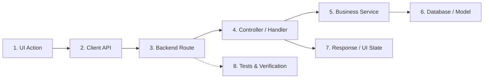

# The 8-Layer Feature Connection Map

The **Feature Connection Map** is Ghost Hunt's core static analysis and contract verification engine. It builds a directed graph of all components involved in a feature's execution, evaluates cross-layer contracts, and uncovers wiring defects before code is executed.

---

## 1. The 8 Architectural Layers

Ghost Hunt models modern web applications across 8 distinct architectural layers:



| Layer | Component | Identification Mechanism | Key Discovered Properties |
|---|---|---|---|
| **1. UI Action** | Button, Link, Form, Input | JSX/TSX/HTML parser | Label, target handler, form action, empty handlers (`onClick={() => {}}`) |
| **2. Client API** | Client network call | Lexical/AST scan for `fetch()`, `axios`, API clients | HTTP method, normalized endpoint path, caller function, app boundary |
| **3. Backend Route** | Web framework route | Parser-backed AST / framework regex | Route path, accepted HTTP methods, sensitivity level |
| **4. Controller / Handler** | Route handler function | AST function visitor | Function name, line range, local auth decorators, empty stub detection |
| **5. Business Service** | Domain service / manager | AST call extractor & symbol table | Service name, called method, unfinished stubs (`NotImplementedError`) |
| **6. Database / Model** | ORM model / query | ORM class inspection & query patterns | Model names, mutation counts (`add`, `delete`), queries, atomic transactions |
| **7. Response / UI State** | Response payload & status | AST return inspection & client consumption | Status code, serialization format (JSON/HTML), client unconsumed payload check |
| **8. Tests & Verification** | Test assertions | Test block inspector across pytest, jest, etc. | Active assertions (`assert res.status_code == 200`) vs passive mentions |

---

## 2. Cross-Layer Contract Checks

When constructing the graph, Ghost Hunt verifies that contracts between adjacent layers are satisfied:

### A. UI to Client API Contracts
- **`unattached_ui_handler`:** Flagged when an interactive element (button, submit input) has no event handler or form action.
- **`empty_inline_handler`:** Flagged when a button has a no-op handler (`onClick={() => {}}`).
- **`named_callback`:** Connects a UI button's callback name to the client API call defined in that function.

### B. Client API to Route Contracts
- **`monorepo_isolation`:** In monorepos with multiple applications, client calls originating in App A are barred from matching routes in App B unless an explicit API gateway or shared contract is configured.
- **`path_mismatch`:** Client targets an endpoint path that does not exist on the backend.
- **`method_mismatch`:** Client sends an HTTP method (e.g. `POST`) not accepted by the route (e.g. `['GET']`), exposing users to runtime HTTP 405 Method Not Allowed errors.

### C. Route to Controller & Service Contracts
- **`unimplemented_handler`:** Handler body consists solely of `pass`, `...`, or `raise NotImplementedError`.
- **`missing_auth`:** Sensitive endpoints (containing `/admin`, `/delete`, `/payment`, `/billing`) lacking local auth decorators or application-level middleware.
- **`missing_service`:** Handler calls a domain service function that is never declared anywhere in the project.
- **`unfinished_service`:** Handler calls a declared service whose implementation is an unfinished stub.

### D. Service to Database Contracts
- **`transaction_boundary`:** Handler or service performs two or more database write mutations without an atomic transaction wrapper, risking partial commits upon failure.

### E. Controller to Response & UI State Contracts
- **`unconsumed_response`:** Backend route returns structured JSON data, but frontend client drops or ignores the returned response payload, leaving UI state stale.

### F. Route to Test Contracts
- **`testing_gap`:** Route lacks any covering test cases.
- **`passive_test_assertion`:** Test case references the route path (e.g. in test fixture setup or URL string) but never asserts on its response status code or response body.

---

## 3. CLI Command Usage

The Feature Connection Map is accessible via the `ghost-hunter map` command:

```bash
# General map for the entire application
ghost-hunter map -p /path/to/project

# Filter connection map to a specific feature or route
ghost-hunter map checkout -p /path/to/project

# Generate Mermaid flowchart for documentation or diagrams
ghost-hunter map checkout -p /path/to/project --mermaid

# Output raw JSON model for tooling and scripts
ghost-hunter map checkout -p /path/to/project --json

# Save output to a file
ghost-hunter map checkout -p /path/to/project --mermaid -o docs/checkout-map.mmd
```

---

## 4. Agent Skill Mode Usage

When using an AI coding agent, invoke the connection map directly in chat:

```text
/ghost-hunt map checkout
```

Or ask naturally:
> *"Show me the connection map for the checkout feature and identify any broken contracts."*
